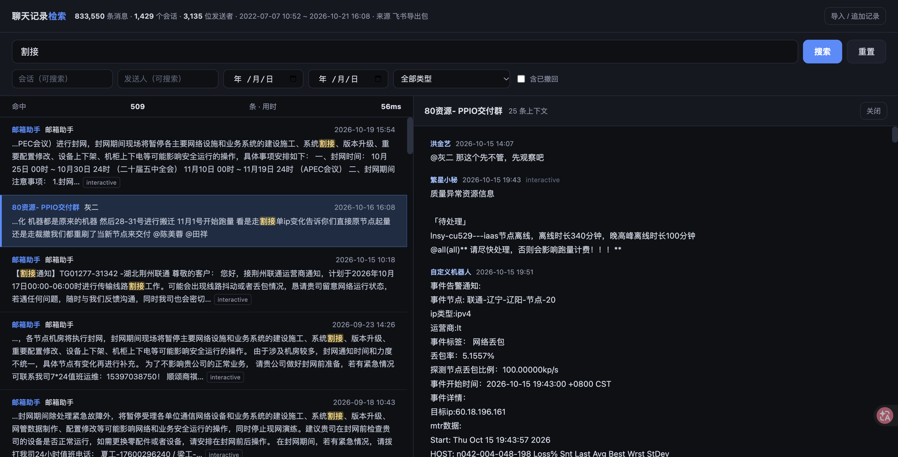

---
AIGC:
    Label: "1"
    ContentProducer: 001191440300708461136T1XGW3
    ProduceID: dc1f9365f5c0b69ca1bfc4be0972c4a3_d817d85cd75e11f1a286525400638852
    ReservedCode1: TCP6ks7n6D5ILDEbK6Qcvs4wuBMIMm2FaiRNF3Ek3kX9RoOSHcLW8oZvSwsQlrpFcovG+pZGJjF2ro2EUnsV8Iucm89Api7qWCuNQuCyeCTEQSFu4zuduD4AMiUap5OVqqVdmvEKvgg30ZgFGJKMo7nAJ/RIIASLLEj4iMGfXnhvlqvTmQs9bddEu0o=
    ContentPropagator: 001191440300708461136T1XGW3
    PropagateID: dc1f9365f5c0b69ca1bfc4be0972c4a3_d817d85cd75e11f1a286525400638852
    ReservedCode2: TCP6ks7n6D5ILDEbK6Qcvs4wuBMIMm2FaiRNF3Ek3kX9RoOSHcLW8oZvSwsQlrpFcovG+pZGJjF2ro2EUnsV8Iucm89Api7qWCuNQuCyeCTEQSFu4zuduD4AMiUap5OVqqVdmvEKvgg30ZgFGJKMo7nAJ/RIIASLLEj4iMGfXnhvlqvTmQs9bddEu0o=
---

# local-chat-search

[](https://github.com/D-if-fi/local-chat-search/actions/workflows/ci.yml)
[](LICENSE)
[](https://www.python.org/)

Turn your exported chat history into an **offline, full-text searchable** local database. No data ever leaves your machine.

Zero third-party dependencies — Python standard library only. The service binds to `127.0.0.1`, writes nothing but `data/chat_search.db`, and requires no account, no network, no telemetry.



## Why

Chat exports are usually hundreds of JSON files inside a zip; finding "what did we decide about that maintenance window" means scrolling forever. Uploading years of conversations to a web tool is not an option.

This project does one thing: **make the export searchable locally**, then give you a clean search page.

- 833k messages: import in ~1–1.5 min, queries in milliseconds
- Single-file, dependency-free, no server, no account, no telemetry
- Any source works as long as it has time / sender / text

## Quick start

Requires Python 3.8+ (macOS / Windows / Linux). No `pip install`.

```bash
git clone https://github.com/<your-name>/local-chat-search.git
cd local-chat-search
python3 app/server.py          # http://127.0.0.1:8777
```

Or double-click `启动检索.command` (macOS) / `启动检索.bat` (Windows).

On first open the page shows a drag-and-drop import wizard. Re-importing the same export is idempotent — messages are deduplicated by a stable `mid`, so you can append new exports anytime.

```bash
python3 app/server.py 8888                          # custom port
CHAT_SEARCH_DATA=~/my-chat-db python3 app/server.py  # custom data dir
```

## Supported inputs

| Input | Notes |
| --- | --- |
| Feishu / Lark export zip | `chats/*.json` + `chat_list.json`; parses chat name, sender, message type, recalled flags |
| Generic JSON / JSONL | field names auto-detected (see below), single file or zipped |
| Plain text | one message per line, leading timestamp such as `[2024-03-02 09:00:12] Alice: text`; indented continuation lines are merged into the previous message |
| CSV | convert first with `tools/csv_to_jsonl.py` |

Recognised field names (case / underscore / space insensitive):

| Purpose | Keys |
| --- | --- |
| time | `time` `create_time` `timestamp` `ts` `date` `datetime` (epoch seconds/millis or date string) |
| sender | `sender` `from` `name` `username` `author` |
| text | `content` `text` `message` `msg` `body` |
| chat | `chat_name` `chat` `group` `title` `conversation` `room` |

Samples for all three formats live in `examples/`.

## Search

- Space-separated keywords are AND-ed
- Wrap in double quotes for phrase match: `"bandwidth cutover"`
- Filter by chat, sender, date range, message type, recalled-only
- Click a hit to see 12 messages of surrounding context

## Privacy

- Everything lives in `data/chat_search.db`; delete it to start over
- Binds `127.0.0.1` only — not reachable from the LAN
- `.gitignore` excludes `data/` and `*.db`; CI fails the build if either is committed
- Images / voice / video have no text in the source data, so only placeholder markers are indexed (no OCR)

## Development

```bash
python3 tests/smoke_test.py     # start server → import examples → search → clean up
```

To add a new export format, implement a parser class in `app/importer.py` (`label` / `sniff` / `parse`) and register it in the `PARSERS` list at the bottom. See [CONTRIBUTING.md](CONTRIBUTING.md) and [docs/ARCHITECTURE.md](docs/ARCHITECTURE.md).

## Known limitations

- Index granularity is character bigrams: terms of ≥2 chars hit the index (ms), single-char queries fall back to a `LIKE` full scan (~1s at 800k rows)
- No searching inside images or audio (no text in source)
- Chinese filenames in the zip require UTF-8 support when extracting on Windows (default since Win10)

## License

[MIT](LICENSE)
*（内容由AI生成，仅供参考）*
