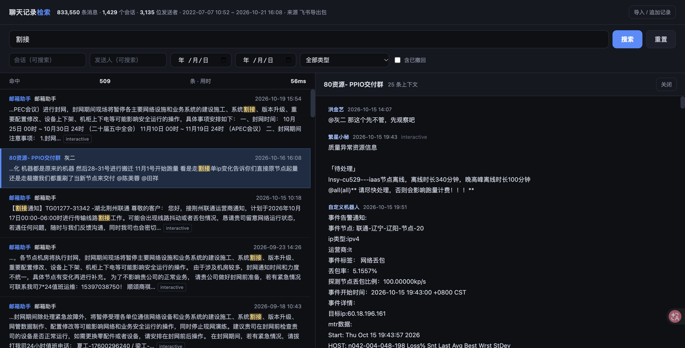

# local-chat-search

把自己导出的聊天记录变成**离线、可全文检索、数据不出本机**的本地资料库。

零第三方依赖（只用 Python 标准库），一条命令或双击脚本就能跑；所有数据只写本机的 `data/chat_search.db`，服务只监听 `127.0.0.1`，不联网、不上传、不需要账号。



## 为什么做这个

聊天记录导出包通常是几百个 JSON 文件堆在一个 zip 里，想找「上次那个割接窗口怎么定的」只能靠翻。把它塞进任何一个在线工具都意味着把自己几年的对话上传给第三方。

这个项目只做一件事：**在本机把导出包变成一个能搜的库**，然后给一个干净的搜索页。

- 83 万条消息实测：导入约 1~1.5 分钟，检索毫秒级
- 单文件、无依赖、无服务端、无账号、无遥测
- 支持多格式，任何来源的聊天记录只要有时间/发送人/内容就能进来

## 快速开始

需要 Python 3.8+（macOS / Windows / Linux 均可），不需要 `pip install` 任何东西。

```bash
git clone https://github.com/<your-name>/local-chat-search.git
cd local-chat-search
python3 app/server.py          # 默认 http://127.0.0.1:8777
```

或者直接双击：

| 平台 | 双击 |
| --- | --- |
| macOS | `启动检索.command` |
| Windows | `启动检索.bat` |

浏览器打开后首次会弹导入向导，把导出包拖进去即可。macOS 首次双击如提示「无法打开」，右键 → 打开，或执行一次 `chmod +x 启动检索.command`。

指定端口 / 指定数据库位置：

```bash
python3 app/server.py 8888
CHAT_SEARCH_DATA=~/my-chat-db python3 app/server.py
```

## 支持的输入

| 输入 | 说明 |
| --- | --- |
| 飞书聊天记录导出包 | zip 内含 `chats/*.json` + `chat_list.json`，自动识别会话名、发送人、消息类型与撤回状态 |
| 通用 JSON / JSONL | 自动识别常见字段名，见下表；单文件或打包成 zip 均可 |
| 纯文本 | 行首带时间戳的 txt，如 `[2024-03-02 09:00:12] 张三: 内容`；缩进续行自动并入上一条 |
| CSV | 先用 `tools/csv_to_jsonl.py` 转成 JSONL，再导入 |

字段名不用改，会自动匹配（大小写、下划线、空格不敏感）：

| 用途 | 可识别的字段名 |
| --- | --- |
| 时间 | `time` `create_time` `timestamp` `ts` `date` `datetime`（秒 / 毫秒时间戳或日期字符串都行） |
| 发送人 | `sender` `from` `name` `username` `author` |
| 内容 | `content` `text` `message` `msg` `body` |
| 会话 | `chat_name` `chat` `group` `title` `conversation` `room` |

重复导入同一份包**不会**产生重复数据（按消息唯一 mid 去重），所以每次导出新记录后直接再拖进去就能增量合并。

`examples/` 里三种格式各有一份样例，可以直接拿来跑通流程。

## 搜索能力

- 关键词全文检索，空格分隔多个词 = 同时包含
- 双引号包住按整体短语匹配，如 `"带宽 割接"`
- 按会话、发送人、日期范围、消息类型筛选，可只查已撤回消息
- 点结果查看该条消息前后各 12 条原始上下文

## 隐私

- 数据只写在 `data/chat_search.db`，删掉即回到初始状态
- 服务只绑 `127.0.0.1`，同局域网其它设备也访问不到
- 仓库 `.gitignore` 已排除 `data/`、`*.db`，CI 会检查误提交
- 图片、语音、视频、表情在源数据里没有文字，只能检索到占位标记，不做 OCR

## 目录结构

```
local-chat-search/
├── app/
│   ├── server.py        本地 HTTP 服务 + SQLite 检索（标准库）
│   ├── importer.py      导出包解析与多格式适配
│   └── index.html       单页检索界面
├── tools/csv_to_jsonl.py  CSV → JSONL 转换
├── examples/            三种格式的样例数据
├── tests/smoke_test.py  端到端冒烟测试
├── docs/ARCHITECTURE.md 实现说明：表结构、索引策略、检索路由
├── 启动检索.command      macOS 启动脚本
└── 启动检索.bat          Windows 启动脚本
```

## 开发

```bash
python3 tests/smoke_test.py     # 起服务→导入 examples→检索→清理，退出码 0 即通过
```

想接入新的导出格式，只需在 `app/importer.py` 里加一个解析器类（实现 `label` / `sniff` / `parse`），然后挂到文件末尾的 `PARSERS` 列表，检索与界面无需改动。细节见 [CONTRIBUTING.md](CONTRIBUTING.md) 与 [docs/ARCHITECTURE.md](docs/ARCHITECTURE.md)。

## 已知限制

- 一个消息分词粒度是字符 bigram：≥2 字的词走索引（毫秒级），单字查询回退 `LIKE` 全表扫描（80 万条约 1 秒）
- 不支持图片/语音内容检索（源数据无文字）
- Windows 上中文文件名解压需系统支持 UTF-8（Win10 及以上默认可以）

## License

[MIT](LICENSE)
